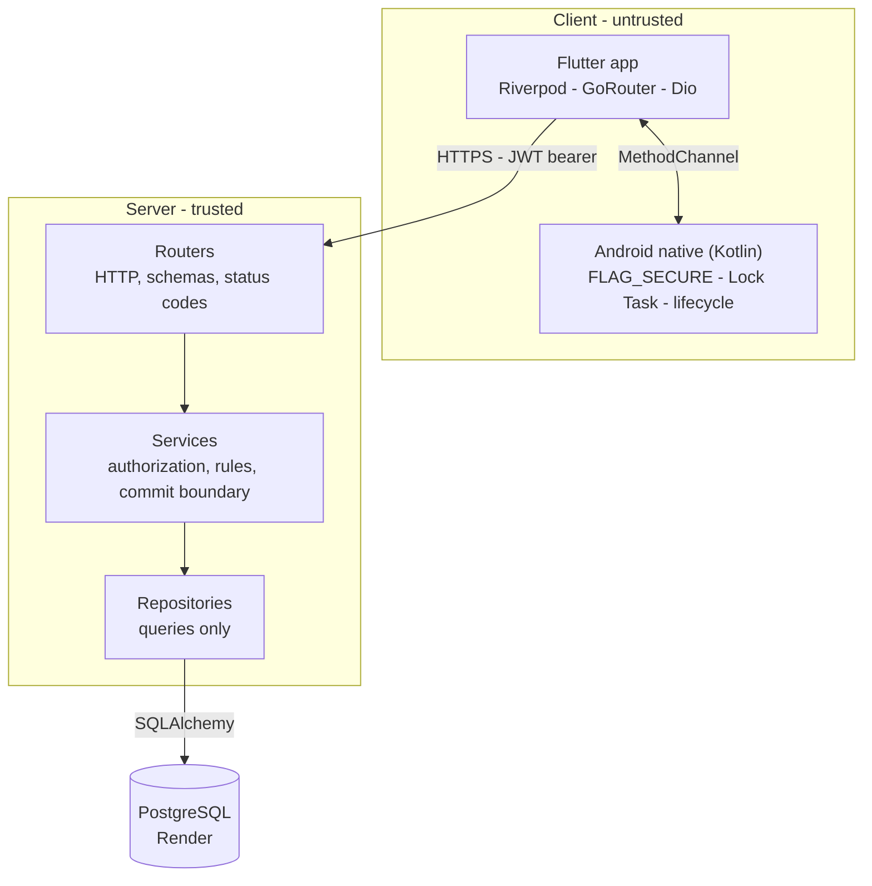
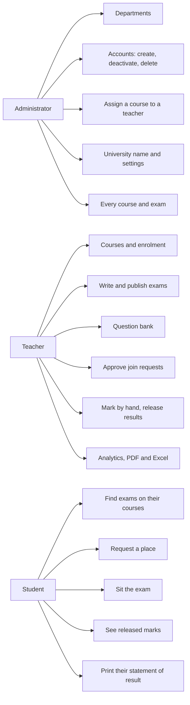
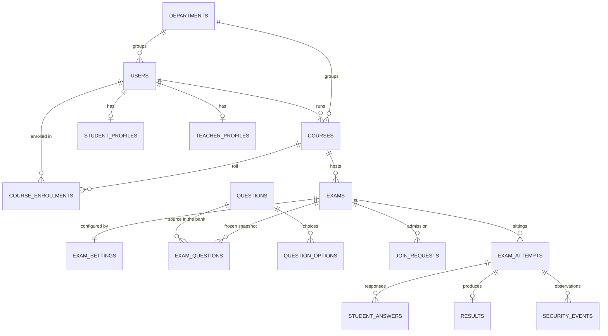
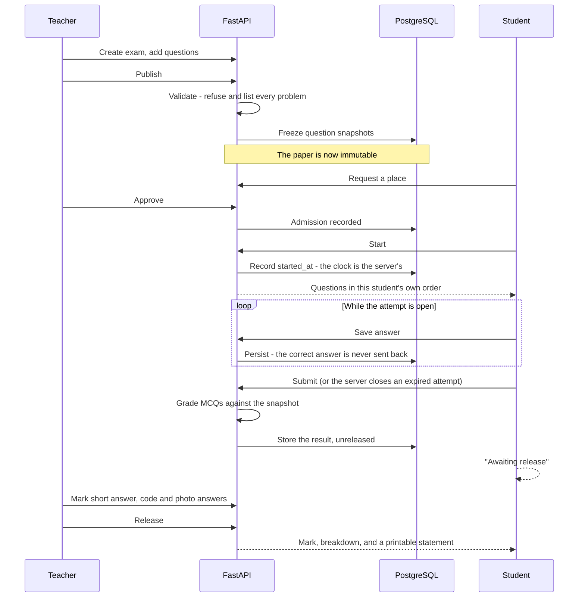

# UniExam

A secure university examination platform. Teachers set papers, students sit them under a
server-owned clock, and marks are computed and released server-side.

**Flutter** client (Android, with a web build for development) · **FastAPI** backend ·
**PostgreSQL** on **Render** · Android-native exam lockdown in **Kotlin**.

---

## Status

The full workflow runs end to end: an administrator registers a department, a course and
its people; a teacher writes and publishes an exam; a student requests a place, is
admitted, sits the paper under a server-owned timer with per-student shuffling, submits,
is graded, and sees the mark once the teacher releases it. Reports print.

| Area | State |
|---|---|
| Foundation, auth, RBAC, admin user management | Done |
| Departments, courses, enrolment, course assignment | Done |
| Exam creation, settings, publish validation, snapshot freezing | Done |
| All six question types, including validated image upload | Done |
| Question bank with reuse and search | Done |
| Join requests and teacher approval | Done |
| Attempt engine, server-side timer, per-student randomisation | Done |
| MCQ auto-grading; short answer, code and photo marked by hand | Done |
| Results with teacher-controlled release | Done |
| Analytics, PDF and Excel export | Done |
| Android secure exam mode | Built; **not yet verified on real hardware** |
| Notifications | In-app done; push needs Firebase credentials |
| Sandboxed code execution | **Not built.** Code answers are marked by a human |

87 endpoints, 20 tables, 12 migrations, 375 backend tests, 290 Flutter tests.

---

## Architecture



The app never talks to PostgreSQL. Every authorization decision, every timestamp and
every mark is computed on the server; the client renders state it is handed.

**What the server owns, and the client cannot influence**

- **The clock.** The countdown on screen is cosmetic. The server records when an attempt
  started, decides when it expired, and closes it regardless of what the device says.
- **The correct answer.** It is never serialised into a student-facing response, so it
  cannot be read out of the payload.
- **The mark.** Grading runs against a frozen snapshot of the question taken at publish
  time, so editing a question afterwards cannot change a paper already sat.
- **Who may see what.** Role plus row ownership, checked in the service layer. A teacher
  holding a teacher role is not enough; the row's owner must match.

Where the existence of a record is itself a disclosure, the API answers **404 rather than
403** — a teacher probing another teacher's course learns nothing from the status code.

---

## What each role can do



Accounts are normally **deactivated**, not deleted — a deactivated account cannot sign in
but its history survives. Deleting is offered as well, and says exactly what it destroys
before it does it, including work belonging to students who are not being deleted.

---

## Question types

| Type | Answered with | Marked |
|---|---|---|
| `TEXT_MCQ` | One option of several | Automatically |
| `IMAGE_TEXT_OPTIONS` | Image question, text options | Automatically |
| `IMAGE_IMAGE_OPTIONS` | Image question, image options | Automatically |
| `SHORT_ANSWER` | Typed prose | By hand |
| `CODE_ANSWER` | Typed code | By hand |
| `PHOTO_ANSWER` | Up to three camera photographs of work on paper | By hand |

`PHOTO_ANSWER` exists for anything a keyboard is the wrong tool for — a derivation, a
circuit, a proof — where typing the answer would test transcription rather than the
subject. The student writes on paper and photographs it; the camera is required, so a
picture cannot be chosen from the gallery.

Uploaded images are stored **in the database**, not on disk. Render's free tier has no
persistent disk, and a container restart used to take every uploaded question image with
it.

---

## Data model

Twenty tables. The ones that carry the exam workflow:



**`EXAM_QUESTIONS` is the important one.** Publishing an exam copies each question into a
snapshot with its marks. Grading reads the snapshot, never the live bank entry, so a
teacher editing a question next term cannot retroactively change a paper somebody
already sat.

A student is filed by **year of the programme** (1 to 4) and **which half of it** (1 or
2), which is how the university describes where somebody is. Courses are filed the same
way.

---

## The exam, start to finish



If the device dies mid-exam, nothing is lost: the server closes an expired attempt the
next time it is read, and a cron job sweeps the rest.

---

## Repository layout

```
UniExam/
├── backend/                 FastAPI + SQLAlchemy + Alembic
│   ├── app/
│   │   ├── core/            config, database, security, dependencies
│   │   ├── models/          SQLAlchemy tables
│   │   ├── schemas/         Pydantic request and response shapes
│   │   ├── routers/         HTTP layer, 87 endpoints
│   │   ├── services/        authorization and rules; owns the commit boundary
│   │   ├── repositories/    queries only
│   │   └── utils/           seeding, sweeps, upload import
│   ├── alembic/versions/    12 migrations
│   └── tests/               375 pytest tests
├── mobile/                  Flutter client
│   ├── lib/
│   │   ├── config/          theme, routes, router
│   │   ├── core/            API client, tokens, exam security channel
│   │   ├── models/          plain Dart types
│   │   ├── repositories/    one per API area
│   │   ├── providers/       Riverpod
│   │   ├── features/        screens, by role
│   │   └── widgets/         shared components
│   ├── test/                290 unit and widget tests
│   ├── integration_test/    end-to-end, nothing faked
│   └── android/             Kotlin lockdown, manifest, Gradle
├── docs/                    architecture, database, api, security, verification
├── docker-compose.yml
└── render.yaml              Render blueprint
```

The layering is enforced by convention and reviewed: routers do not query, repositories
do not authorize, and services own every `commit()`.

---

## Running the backend

```bash
cd backend
python -m venv .venv
.venv\Scripts\activate            # Windows; source .venv/bin/activate elsewhere
pip install -r requirements-dev.txt

cp .env.example .env               # then set DATABASE_URL and JWT_SECRET_KEY
alembic upgrade head
python -m app.utils.seed --demo    # first admin plus a demo department, teacher, student, course
uvicorn app.main:app --reload
```

- API: <http://127.0.0.1:8000>
- Swagger: <http://127.0.0.1:8000/docs>
- Health: <http://127.0.0.1:8000/health>

Generate a JWT secret with:

```bash
python -c "import secrets; print(secrets.token_urlsafe(48))"
```

### Configuration

| Variable | Default | Notes |
|---|---|---|
| `DATABASE_URL` | local SQLite | Render's external URL for Postgres; `postgres://` is normalised |
| `JWT_SECRET_KEY` | dev placeholder | Refused in production if left at the placeholder |
| `ACCESS_TOKEN_EXPIRE_MINUTES` | `30` | |
| `REFRESH_TOKEN_EXPIRE_DAYS` | `7` | Rotated on every refresh |
| `CORS_ORIGINS` | empty | Comma-separated; must match the Flutter web origin exactly |
| `UNIVERSITY_NAME` | `University` | Seed only. An admin sets the live value in the app |
| `MAX_UPLOAD_SIZE_MB` | `10` | |
| `LOGIN_RATE_LIMIT` | `10/minute` | |
| `FIRST_ADMIN_PASSWORD` | empty | Used once, by the seeder |

`.env` is never committed, and neither are Render credentials or uploaded files.

### Pointing at Render PostgreSQL

Copy the **External Database URL** from the Render database into `DATABASE_URL`, then run
`alembic upgrade head` against it.

### Scheduled work

```bash
python -m app.utils.sweep_attempts     # close attempts whose time ran out
```

The app asks the server to submit when its countdown reaches zero, and the server closes
an expired attempt whenever one is read — but neither helps if a device died mid-exam.
Run this as a Render Cron Job as the backstop:

```
*/5 * * * *   python -m app.utils.sweep_attempts
```

### Demo accounts (after `--demo`)

| Role | User ID | Password |
|---|---|---|
| Admin | `admin` | value of `FIRST_ADMIN_PASSWORD` |
| Teacher | `T1001` | `Passw0rd!123` |
| Student | `20261234` | `Passw0rd!123` |

For local development only.

---

## Running the app

```bash
cd mobile
flutter pub get
```

**Android** — the production target:

```bash
flutter run --dart-define=API_BASE_URL=http://10.0.2.2:8000/api/v1
```

`10.0.2.2` is the emulator's alias for the host machine. On a physical device use the LAN
address (`http://192.168.x.x:8000/api/v1`); against a deployed backend use the HTTPS URL.
Debug builds permit cleartext HTTP to `10.0.2.2` and `localhost` only. Release builds are
HTTPS-only.

**Chrome** — for fast iteration:

```bash
flutter run -d chrome --web-port=5000 \
  --dart-define=API_BASE_URL=http://localhost:8000/api/v1
```

Pin `--web-port` so the origin matches `CORS_ORIGINS`. Flutter Web is a development
convenience only: secure storage falls back to browser storage, and none of the Android
lockdown protections exist in a browser. **Exams are sat on Android.**

**Release APK:**

```bash
flutter build apk --release \
  --dart-define=API_BASE_URL=https://<your-api>.onrender.com/api/v1
```

Note on version codes: `--split-per-abi` adds an ABI offset to `versionCode`
(+1000 for armeabi-v7a, +2000 for arm64-v8a). A later universal build with a lower
`versionCode` therefore looks like a downgrade to Android and installs with a bare
"App not installed". Keep the number ahead of whatever is on the device.

---

## Tests

```bash
# Backend - 375 tests, against a schema Alembic builds
cd backend && .venv/Scripts/python -m pytest

# ...and the same suite against real PostgreSQL
TEST_DATABASE_URL="postgresql://..." .venv/Scripts/python -m pytest

# Flutter - 290 unit and widget tests, network faked
cd mobile && flutter analyze && flutter test
```

**End to end** — real app, real API, real PostgreSQL. Needs the backend running and
seeded, plus a `chromedriver` matching the installed Chrome:

```bash
chromedriver --port=4444 &
cd mobile
flutter drive --driver=test_driver/integration_test.dart \
  --target=integration_test/app_test.dart \
  -d web-server --browser-name=chrome --web-port=5000 \
  --dart-define=API_BASE_URL=http://localhost:8000/api/v1
```

On a device or emulator the same suite runs without chromedriver:

```bash
flutter test integration_test -d <device-id> \
  --dart-define=API_BASE_URL=http://10.0.2.2:8000/api/v1
```

The backend suite runs against a database built by **Alembic**, so a migration that
drifts from the models fails the tests rather than the deployment. Foreign keys are
enforced under SQLite too, so `ON DELETE CASCADE` and `RESTRICT` are exercised rather
than silently ignored. The widget tests run under the **shipped theme**, because a theme
bug that only appears in production is one the tests should catch.

---

## Deploying to Render

Push the repository, then **New → Blueprint** and point Render at `render.yaml`. It
creates the PostgreSQL instance and the Docker web service, wires `DATABASE_URL`,
generates `JWT_SECRET_KEY`, and health-checks `/health`. Set `CORS_ORIGINS` and
`FIRST_ADMIN_PASSWORD` in the dashboard. Migrations run on container start, so a deploy
applies them.

Two things worth knowing about the free tier:

- **No persistent disk.** Anything written to the container filesystem is gone on
  restart. This is why uploaded images live in the database.
- **Cold starts.** A service idle for about fifteen minutes takes roughly forty seconds
  to answer the next request. The app's timeouts allow for it and the splash screen warms
  the API up.

**If a deploy never happens:** check the deploy list rather than the push. Render can
only build what its GitHub App can read, and a private repository whose access has been
revoked fails both the webhook and a manual trigger.

```bash
curl -H "Authorization: Bearer $RENDER_KEY" \
  https://api.render.com/v1/services/<service-id>/deploys?limit=5
```

Comparing the deployed `/openapi.json` against the local schema is the quickest
whole-picture check: grep it for something added since the last deploy.

---

## Documentation

| Document | Contents |
|---|---|
| [docs/architecture.md](docs/architecture.md) | System diagram, layering, request lifecycle, trust boundary, phase map |
| [docs/database.md](docs/database.md) | Full ER diagrams, DDL, integrity rules, migration workflow |
| [docs/api.md](docs/api.md) | Endpoint reference, conventions, per-audience response schemas |
| [docs/security.md](docs/security.md) | Auth design, token rotation, RBAC, uploads, lockdown |
| [docs/android-verification.md](docs/android-verification.md) | What to check on real hardware, and how |

---

## What this does not claim

The Android exam mode uses `FLAG_SECURE`, Lock Task where the device allows it, and
lifecycle monitoring, and it reports what it observes. It is a deterrent on hardware the
university does not control.

**A normal personal Android phone is not a cheat-proof examination device**, and this
platform does not pretend otherwise. A second device, a printed page or another person in
the room are all outside what any app can see.

For the same reason the security events the device reports — the app going to the
background, a screenshot attempt, a screen recorder — are recorded as **observations, not
accusations**. Several have innocent explanations: a phone call arrives, the network
drops. The record exists so a human invigilator can interpret it. The platform never
draws a conclusion from it, and never flags a student as a cheat.

Code answers are **marked by a human**. Sandboxed execution of student code is not built,
and untrusted code will not be run on the API server.
