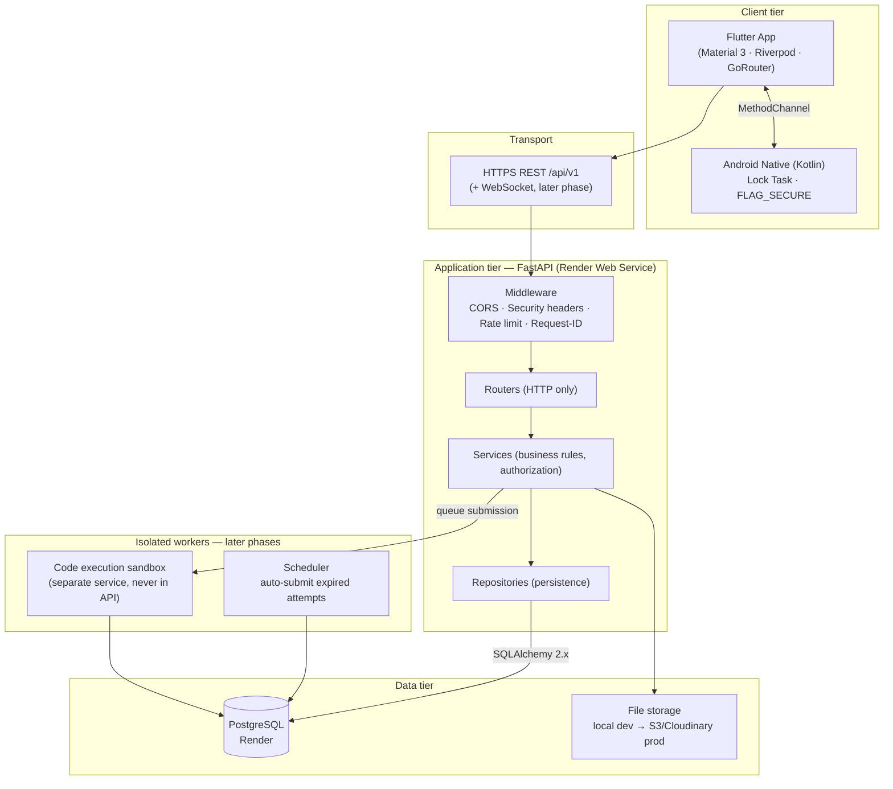
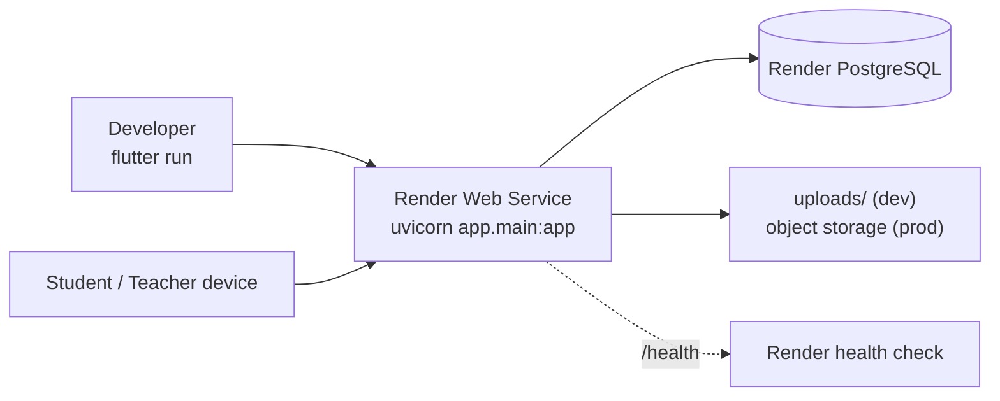

# UniExam — System Architecture

> Status: **Phase 1 (Foundation) implemented.** Later phases are specified here so the
> foundation is built to receive them without rework.

---

## 1. High-level architecture



**Non-negotiable rule:** Flutter never opens a database connection. The only way to
reach PostgreSQL is through the FastAPI HTTP API.

---

## 2. Layered backend

```
HTTP request
   ↓
middleware/      cross-cutting: request id, security headers, CORS, rate limit
   ↓
routers/         parse + validate (Pydantic), resolve current user, return schemas
   ↓
services/        business rules, authorization decisions, transactions
   ↓
repositories/    SQLAlchemy queries; the only layer that knows about ORM sessions
   ↓
models/          SQLAlchemy 2.x declarative mappings
   ↓
PostgreSQL
```

Rules enforced in this codebase:

| Layer | May do | Must never do |
|---|---|---|
| `routers/` | HTTP concerns, dependency injection, response models | contain business rules or raw queries |
| `services/` | rules, ownership checks, orchestration, commit boundaries | touch `Request`/`Response`, build SQL strings |
| `repositories/` | queries, filters, joins, pagination | decide who is allowed to do what |
| `models/` | schema, constraints, relationships | contain business logic |

`schemas/` is split per audience. A student-facing schema is a *different class* from a
teacher-facing one — this is how `is_correct` is kept out of student payloads structurally
rather than by remembering to filter it.

---

## 3. Request lifecycle (login)

```mermaid
sequenceDiagram
    participant F as Flutter
    participant M as Middleware
    participant R as auth_router
    participant S as AuthService
    participant P as UserRepository
    participant D as PostgreSQL

    F->>M: POST /api/v1/auth/login {user_id, password}
    M->>M: rate limit (per IP), request-id, CORS
    M->>R: dispatch
    R->>S: authenticate(user_id, password)
    S->>P: get_by_user_id(user_id)
    P->>D: SELECT ... FROM users WHERE user_id = :uid
    D-->>P: row | none
    P-->>S: User | None
    S->>S: verify hash (constant-time; dummy-verify when user missing)
    S->>S: check is_active
    S-->>R: (User, access_token, refresh_token)
    R-->>F: 200 TokenResponse
    Note over F: tokens → flutter_secure_storage<br/>(Keystore/Keychain, never SharedPreferences)
```

---

## 4. Trust boundary

Everything below is computed or verified **server-side only**. The client is a renderer.

```
Client may send            Server decides
------------------------   ---------------------------------------
credentials                identity, role
answer choice (option id)  whether the answer is correct, marks
"submit"                   whether submission is allowed, when it happened
"start exam"               eligibility, started_at, expires_at, question order
                           remaining time, exam status, result visibility
```

The API ignores any client-supplied `marks`, `student_id`, `teacher_id`, `expires_at`,
`status`, or `is_correct`. Those fields are not present in any `*Create`/`*Update` schema.

---

## 5. Deployment topology



Config comes from environment variables only (`DATABASE_URL`, `JWT_SECRET_KEY`,
`CORS_ORIGINS`, …). No host, user, password, or port is ever written in source.

---

## 6. Phase map

| Phase | Scope | State |
|---|---|---|
| 1 | Foundation: FastAPI, SQLAlchemy, Alembic, JWT, RBAC, Flutter shell, login, dashboards | **done** |
| 2 | Auth hardening: refresh rotation, password change, admin user management | partly in 1 |
| 3 | Departments, courses, enrollment (full CRUD + bulk enrol) | models in 1 |
| 4 | Exam creation, settings, publish validation, snapshot freezing | **done** |
| 5 | Question builder — all five types, with validated image upload | **done** |
| 6 | Question bank (reuse and search) | planned |
| 7 | Student exam discovery (role-dispatched responses) | **done** |
| 8 | Join requests and teacher approval, incl. bulk review | **done** |
| 9 | Attempt engine: start authorization, resume, answer saving, submission | **done** |
| 10 | Server-side timer (client countdown is cosmetic) | **done** |
| 11 | Per-student question and answer randomisation | **done** |
| 12 | Android secure exam mode (Kotlin) | **done** — device behaviour untested on hardware |
| 13 | MCQ grading against the frozen snapshot | **done** |
| 14–15 | Short-answer and code grading | planned |
| 16 | Results, with teacher-controlled release | **done** |
| 17 | Analytics — cohort, distribution, per-question accuracy | **done** |
| 18 | PDF and Excel export | **done** |
| 19–21 | Notifications, security testing, Render deploy | planned |
