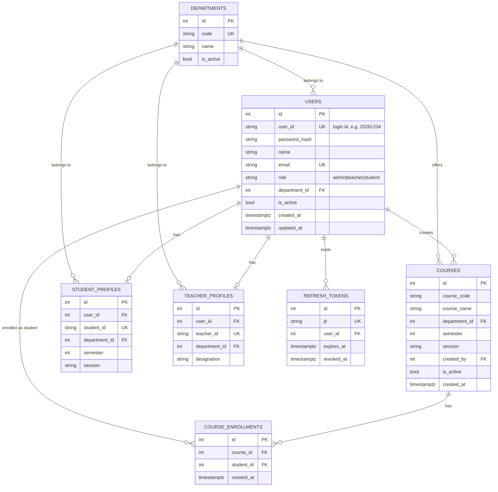
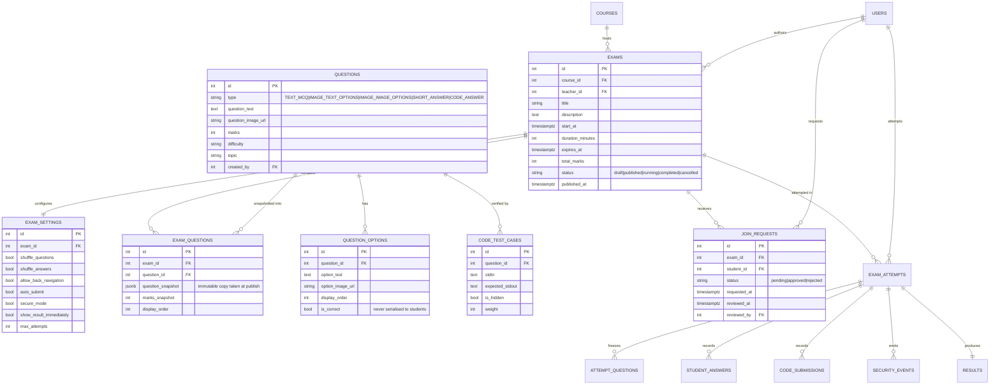
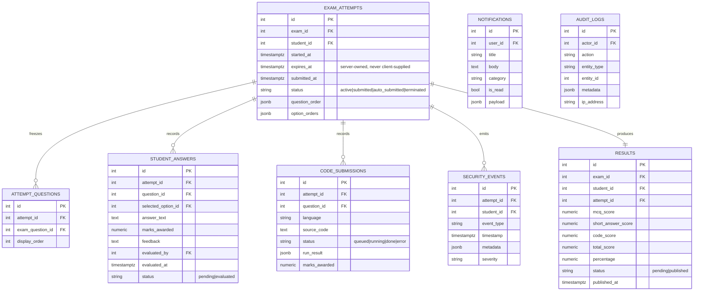

# UniExam — Database Design

Engine: **PostgreSQL** (Render for development). ORM: **SQLAlchemy 2.x**. Migrations: **Alembic**.

Legend: 🟢 = created by the Phase 1 migration · ⚪ = designed now, migrated in its own phase.

---

## 1. Entity–Relationship diagram

### 1.1 Identity & academic core 🟢



### 1.2 Exams, questions & attempts ⚪



### 1.3 Attempt runtime, grading & cross-cutting ⚪



---

## 2. Phase 1 PostgreSQL schema (authoritative)

Produced by `alembic upgrade head`. Enumerations are stored as **VARCHAR + CHECK**, not
native PostgreSQL `ENUM` types: adding a role or status later becomes an ordinary
migration instead of an `ALTER TYPE`, and the identical DDL also runs on SQLite, which is
what the test suite uses.

```sql
CREATE TABLE departments (
    id          SERIAL PRIMARY KEY,
    code        VARCHAR(20)  NOT NULL UNIQUE,
    name        VARCHAR(150) NOT NULL,
    is_active   BOOLEAN      NOT NULL DEFAULT TRUE,
    created_at  TIMESTAMPTZ  NOT NULL DEFAULT now()
);

CREATE TABLE users (
    id             SERIAL PRIMARY KEY,
    user_id        VARCHAR(50)  NOT NULL UNIQUE,
    password_hash  VARCHAR(255) NOT NULL,
    name           VARCHAR(150) NOT NULL,
    email          VARCHAR(255) UNIQUE,
    role           VARCHAR(20)  NOT NULL,
    department_id  INTEGER      REFERENCES departments(id) ON DELETE SET NULL,
    is_active      BOOLEAN      NOT NULL DEFAULT TRUE,
    created_at     TIMESTAMPTZ  NOT NULL DEFAULT now(),
    updated_at     TIMESTAMPTZ  NOT NULL DEFAULT now(),
    CONSTRAINT ck_users_role CHECK (role IN ('admin','teacher','student'))
);
CREATE INDEX ix_users_role          ON users(role);
CREATE INDEX ix_users_department_id ON users(department_id);

CREATE TABLE student_profiles (
    id             SERIAL PRIMARY KEY,
    user_id        INTEGER NOT NULL UNIQUE REFERENCES users(id) ON DELETE CASCADE,
    student_id     VARCHAR(50) NOT NULL UNIQUE,
    department_id  INTEGER REFERENCES departments(id) ON DELETE SET NULL,
    semester       INTEGER,
    session        VARCHAR(20),
    CONSTRAINT ck_student_profiles_semester
        CHECK (semester IS NULL OR (semester >= 1 AND semester <= 12))
);

CREATE TABLE teacher_profiles (
    id             SERIAL PRIMARY KEY,
    user_id        INTEGER NOT NULL UNIQUE REFERENCES users(id) ON DELETE CASCADE,
    teacher_id     VARCHAR(50) NOT NULL UNIQUE,
    department_id  INTEGER REFERENCES departments(id) ON DELETE SET NULL,
    designation    VARCHAR(100)
);

CREATE TABLE courses (
    id             SERIAL PRIMARY KEY,
    course_code    VARCHAR(30)  NOT NULL,
    course_name    VARCHAR(200) NOT NULL,
    department_id  INTEGER REFERENCES departments(id) ON DELETE SET NULL,
    semester       INTEGER,
    session        VARCHAR(20),
    created_by     INTEGER NOT NULL REFERENCES users(id) ON DELETE RESTRICT,
    is_active      BOOLEAN NOT NULL DEFAULT TRUE,
    created_at     TIMESTAMPTZ NOT NULL DEFAULT now(),
    CONSTRAINT uq_courses_code_session UNIQUE (course_code, session)
);
CREATE INDEX ix_courses_created_by    ON courses(created_by);
CREATE INDEX ix_courses_department_id ON courses(department_id);

CREATE TABLE course_enrollments (
    id          SERIAL PRIMARY KEY,
    course_id   INTEGER NOT NULL REFERENCES courses(id) ON DELETE CASCADE,
    student_id  INTEGER NOT NULL REFERENCES users(id)   ON DELETE CASCADE,
    created_at  TIMESTAMPTZ NOT NULL DEFAULT now(),
    CONSTRAINT uq_enrollment_course_student UNIQUE (course_id, student_id)
);
CREATE INDEX ix_course_enrollments_student_id ON course_enrollments(student_id);

CREATE TABLE refresh_tokens (
    id          SERIAL PRIMARY KEY,
    jti         VARCHAR(64) NOT NULL UNIQUE,
    user_id     INTEGER NOT NULL REFERENCES users(id) ON DELETE CASCADE,
    expires_at  TIMESTAMPTZ NOT NULL,
    revoked_at  TIMESTAMPTZ,
    created_at  TIMESTAMPTZ NOT NULL DEFAULT now()
);
CREATE INDEX ix_refresh_tokens_user_id ON refresh_tokens(user_id);
```

`refresh_tokens` is not in the original table list, but refresh-token **rotation and
revocation** are impossible without server-side state: with stateless refresh tokens a
stolen token stays valid until it expires and logout cannot be enforced.

---

## 3. Integrity rules that live in the database

Constraints, not conventions — an application bug cannot violate them.

| Rule | Mechanism | Phase |
|---|---|---|
| One login id per user | `users.user_id UNIQUE` | 1 |
| At most one profile per user | `student_profiles.user_id UNIQUE`, `teacher_profiles.user_id UNIQUE` | 1 |
| A student enrols in a course at most once | `UNIQUE (course_id, student_id)` | 1 |
| Role is one of three values | `CHECK (role IN ('admin','teacher','student'))` | 1 |
| Course code reusable across sessions, unique within one | `UNIQUE (course_code, session)` | 1 |
| A refresh token can be used once | `jti UNIQUE` + `revoked_at` set on rotation | 1 |
| One attempt running per (exam, student) | partial unique index on `(exam_id, student_id) WHERE status = 'active'` — **live** | 9 |
| No duplicate pending join request | partial unique index on `(exam_id, student_id) WHERE status = 'pending'` — **live** | 8 |
| One result per attempt | `results.attempt_id UNIQUE` — **live**; makes submission idempotent | 16 |
| One answer per (attempt, question) | `UNIQUE (attempt_id, exam_question_id)` — **live** | 9 |
| An attempt cannot be submitted twice | `UPDATE ... WHERE status = 'active'`, checked rowcount — **live** | 9 |

## 4. Connection & pooling

`DATABASE_URL` is read from the environment and normalised at startup
(`postgres://` → `postgresql+psycopg://`, the scheme Render hands out vs. the one
SQLAlchemy 2.x needs). Render's managed Postgres drops idle connections, so the engine
sets `pool_pre_ping=True` and `pool_recycle=1800`; pool size is an env var because a free
instance permits far fewer connections than a paid one.

## 5. Migration workflow

```bash
alembic revision --autogenerate -m "describe the change"   # always review the output
alembic upgrade head
alembic downgrade -1                                       # every revision must reverse
```

The production schema is never edited by hand.
